<div align="center">

# Image-to-Text Pattern Matching Pipeline

**Read the text in any document image and find the keywords, phrases and values you care about,<br>even when the OCR gets a few letters wrong.**

[](https://github.com/amartya1056/image-to-text-pattern-matching/actions/workflows/tests.yml)


**[Live app](https://huggingface.co/spaces/amartya1056/MPPM)** · [How it works](#how-it-works-the-six-stages) · [Results](#evaluation-results) · [Run locally](#run-it-locally) · [FAQ](#faq-questions-you-may-be-asked)

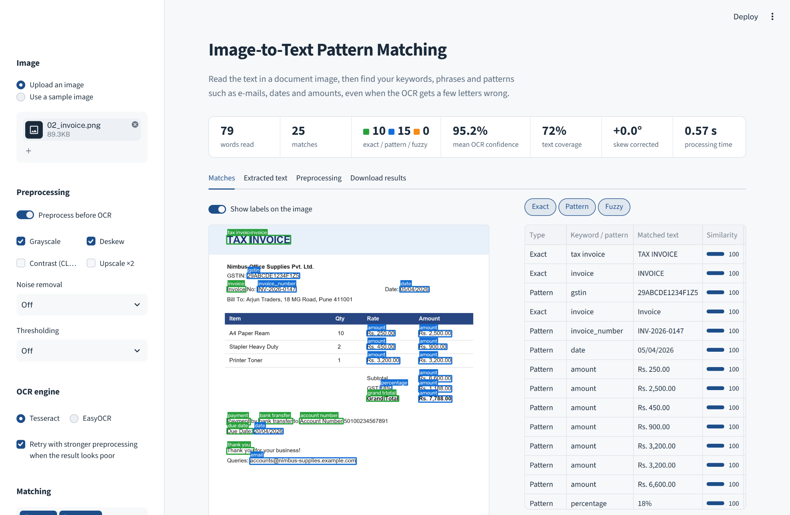

</div>

---

## Table of contents

1. [What this project does](#what-this-project-does)
2. [Try it online](#try-it-online)
3. [Key results at a glance](#key-results-at-a-glance)
4. [Architecture](#architecture)
5. [How it works: the six stages](#how-it-works-the-six-stages)
6. [Data structures that flow through the pipeline](#data-structures-that-flow-through-the-pipeline)
7. [The decision point: detecting a bad OCR pass](#the-decision-point-detecting-a-bad-ocr-pass)
8. [Configuration](#configuration)
9. [Interfaces: CLI and web UI](#interfaces)
10. [Outputs: annotated image, JSON, CSV](#outputs)
11. [Evaluation methodology and results](#evaluation-results)
12. [Design decisions and trade-offs](#design-decisions-and-trade-offs)
13. [Limitations and future work](#limitations-and-future-work)
14. [Project structure](#project-structure)
15. [Run it locally](#run-it-locally)
16. [Testing](#testing)
17. [Deployment](#deployment)
18. [Troubleshooting](#troubleshooting)
19. [FAQ: questions you may be asked](#faq-questions-you-may-be-asked)
20. [References](#references)

---

## What this project does

> **Problem statement:** *Create a pipeline that extracts textual information from an image and applies pattern matching to locate predefined keywords or phrases.*

A lot of everyday information arrives as **pictures of text**: scanned letters, phone photos of receipts, invoices, screenshots, notices and ID cards. Searching them normally means a person has to read them. This project automates that in two halves:

1. **Text extraction:** clean the image up with OpenCV and read it with an OCR engine (Tesseract, with EasyOCR as an optional second engine), keeping the **position and confidence of every word**.
2. **Pattern matching:** search the recognised text for a configurable list of
   * **keywords and phrases** (`invoice`, `due date`, `terms and conditions` …), found **exactly** or **fuzzily** so that OCR errors like `Tota1` or `Bank Transter` still match, and
   * **structured values** with **regular expressions**: e-mails, URLs, phone numbers, dates, invoice numbers, currency amounts, GSTINs, percentages.

Every match is traced back to its words, so it is drawn as a **colour-coded box on the original image** and exported as **JSON and CSV**.

**Where it is useful:** invoice and receipt digitisation · document routing (`urgent`, `confidential`) · compliance checks (mandatory phrases present?) · ID-card field location · phishing / content moderation in screenshots (`password`, `verification`, suspicious links) · making scanned archives searchable.

---

## Try it online

**Live app: [huggingface.co/spaces/amartya1056/MPPM](https://huggingface.co/spaces/amartya1056/MPPM)** (no installation needed)

[](https://huggingface.co/spaces/amartya1056/MPPM)

1. Upload an image (PNG, JPG, JPEG, BMP, TIFF) or click one of the sample images.
2. Choose the preprocessing steps, the OCR engine (**Tesseract** or **EasyOCR**) and the matching modes, then press **Find matches**.
3. Edit the keyword list or upload your own `keywords.json` / `.yaml` under *Keywords and patterns*.
4. Explore the tabs: **Matches** (annotated image + table), **Extracted text** (highlighted), **Preprocessing** (every intermediate image), **Download results** (JSON / CSV / PNG).

> The hosted demo uses the Gradio interface [`app_gradio.py`](app_gradio.py) on a free Hugging Face Space. The richer Streamlit interface [`app.py`](app.py) runs locally. Both call the same `ocrmatch` pipeline.

---

## Key results at a glance

Measured by [`evaluation/evaluate.py`](evaluation/evaluate.py) on 10 labelled test images (10 different document types, each with exact ground truth):

| Configuration | Character accuracy | Word accuracy | Keyword F1 | Regex F1 | Time / image |
|---|:-:|:-:|:-:|:-:|:-:|
| Tesseract on raw images | 86.5 % | 82.3 % | 1.000 | 0.882 | 0.31 s |
| Tesseract + full chain with Otsu | 87.9 % | 71.0 %  | 0.961 | 0.695 | 0.31 s |
| EasyOCR, grayscale + deskew | 93.9 % | 78.2 % | 0.961 | 0.714 | 3.19 s |
| **This pipeline (final)** | **95.8 %** | **93.7 %** | **1.000** | **0.943** | **0.38 s** |

*Keyword F1 uses exact + fuzzy matching at threshold 90; CPU: Intel Core i7-13700HX, no GPU.*

**Three findings that shaped the design:**

* **More preprocessing is not always better.** Forcing Otsu binarisation on every image **dropped word accuracy to 71 %**, because Tesseract already binarises internally and a second hard threshold destroys anti-aliased edges. The pipeline uses light preprocessing by default and heavy preprocessing only when needed.
* **Confidence cannot reveal missed text.** On a low-contrast notice, Tesseract read 11 of 40 words, *each with high confidence* (mean 87.6). A new **text-coverage** check catches this and retries automatically, raising that image from **31 % → 97 %** character accuracy.
* **Fuzzy matching needs a measured threshold.** At 50 it found every keyword but produced 58 false matches; at **90** it reached **precision = recall = 1.000** on the test set.

---

## Architecture

### High-level view

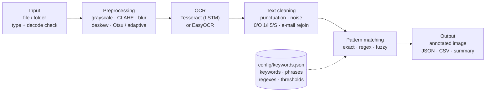

<details>
<summary><b>Same diagram as an image (used in the report)</b></summary>

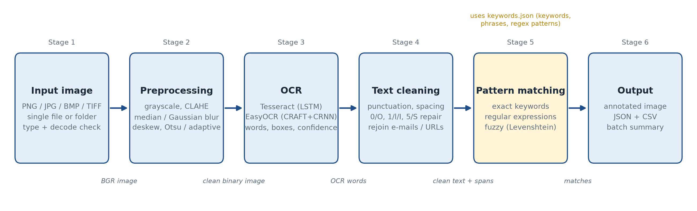
</details>

### Detailed architecture

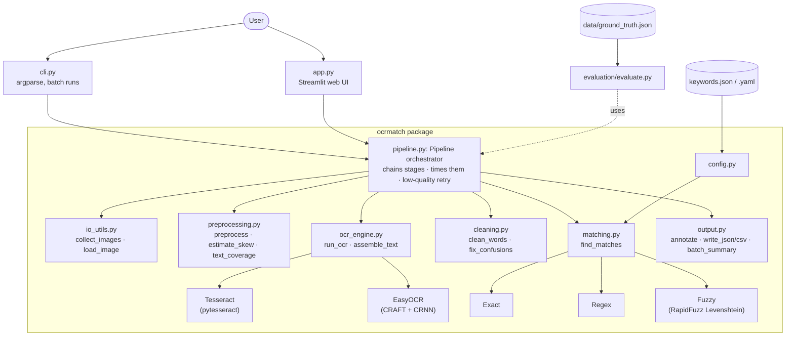

<details>
<summary><b>Detailed architecture as drawn in the report</b></summary>

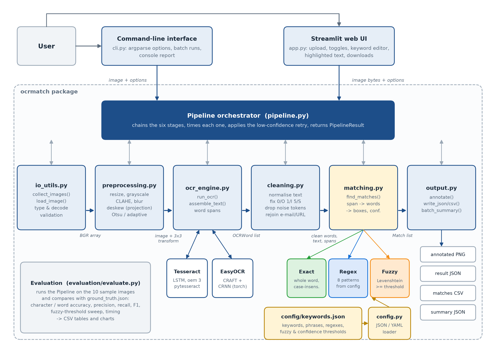
</details>

**Design principle:** each stage is a separate module with one job and a plain-Python interface. The orchestrator is the only place that knows the order. That makes every stage **testable on its own**, **swappable** (e.g. another OCR engine) and **measurable** (every stage is timed).

### What happens on one request (web UI)

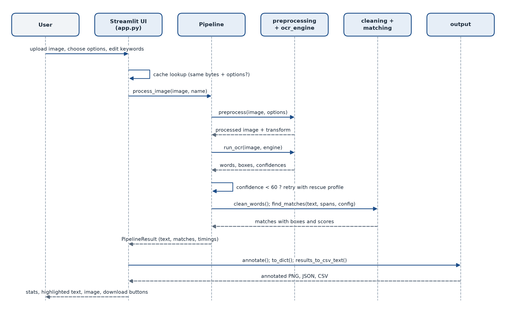

---

## How it works: the six stages

### Stage 1: Input ([`ocrmatch/io_utils.py`](ocrmatch/io_utils.py))

* Accepts **one file or a folder** (optionally recursive). Supported: `.png .jpg .jpeg .bmp .tif .tiff`.
* Files are read with `np.fromfile` + `cv2.imdecode` instead of `cv2.imread`, because `imread` silently fails on Windows paths with non-ASCII characters.
* **Graceful failure:** unsupported or corrupt files raise `ImageLoadError`, which the batch loop records as a failure and moves past. One bad file never stops a batch (see `data/edge_cases/`).

### Stage 2: Preprocessing ([`ocrmatch/preprocessing.py`](ocrmatch/preprocessing.py))

Every step is a **toggle** in `PreprocessOptions`, so its effect can be measured. Order: `resize → grayscale → CLAHE → denoise → deskew → threshold`.

| Step | What it does | When it helps |
|---|---|---|
| **Resize** (×2, bicubic) | Enlarges small text | Tiny fonts, low-resolution photos |
| **Grayscale** | 3 channels → 1 | Always cheap, removes colour noise |
| **CLAHE** | Local histogram equalisation | Faint / low-contrast text |
| **Median / Gaussian blur** | Removes specks / sensor noise | Noisy scans, JPEG artefacts |
| **Deskew** | Rotates the page so lines are horizontal | Tilted scans and photos |
| **Otsu threshold** | One global black/white cut-off | Clean, evenly lit pages |
| **Adaptive threshold** | A threshold per pixel from its neighbourhood | Shadows, lighting gradients |

**Otsu's method** tries every threshold `t` and keeps the one that maximises the between-class variance
`σ²_B(t) = ω₀(t)·ω₁(t)·[μ₀(t) − μ₁(t)]²`. It is parameter-free but assumes the histogram has two clear peaks.
**Adaptive thresholding** uses `T(x,y) = GaussianMean(31×31 neighbourhood) − 15`, so it follows uneven lighting:

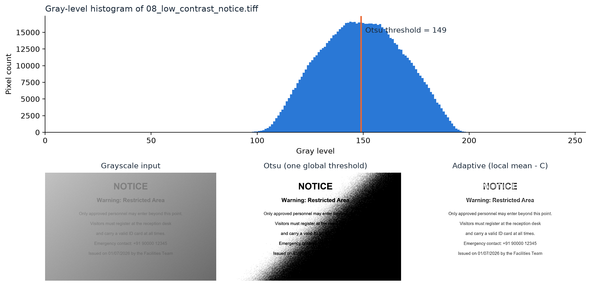

**Deskew (projection profile).** The text is turned into an ink mask (Otsu, inverted; flipped automatically for light-on-dark pages) and shrunk to ≤ 800 px. It is rotated through −15°…+15° in 1° steps, and for each angle the ink pixels per row are counted. When lines are horizontal, the row profile alternates sharply between full rows and empty gaps, so the score `Σ(row[i+1] − row[i])²` peaks. The best angle is refined in 0.1° steps and the image is rotated on an enlarged canvas so no corner is cut.

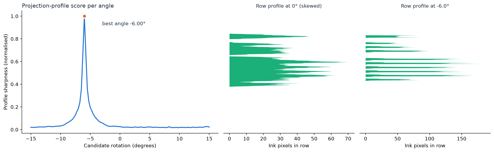

**Coordinate transform.** Every resize/rotation is multiplied into a **3×3 matrix** (original → processed coordinates). OCR finds boxes on the *processed* image; the output stage applies the **inverse matrix** to each box's four corners. That is why boxes land correctly on the user's *original*, still-tilted photo.

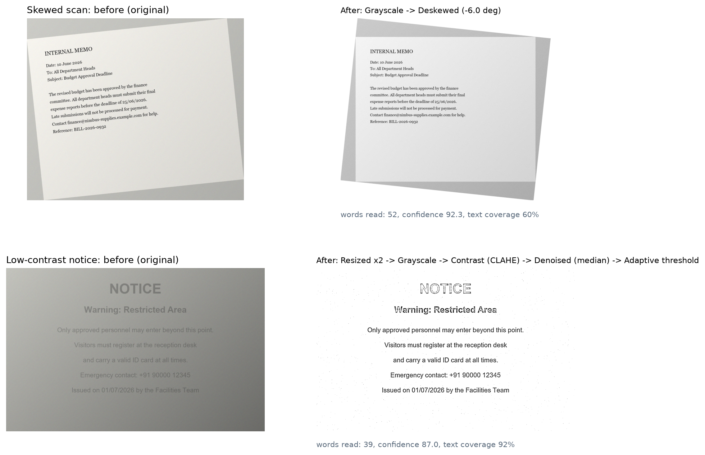

### Stage 3: OCR ([`ocrmatch/ocr_engine.py`](ocrmatch/ocr_engine.py))

* **Tesseract** (`--oem 3`, LSTM engine; `--psm 3`, automatic page segmentation) via `pytesseract.image_to_data`, which returns every word with `left, top, width, height`, a **confidence 0–100**, and block/paragraph/line numbers. Rows with confidence `-1` (page/block/line containers) are skipped.
* **EasyOCR** returns one box per *text segment*, not per word. The wrapper splits each segment into **approximate word boxes** by dividing its width in proportion to character positions, so both engines produce the same `OCRWord` list.
* **`assemble_text`** joins the words into one string (space within a line, newline between lines) and records each word's `(start, end)` **character span**. This span map is the key trick of the project: any match found in the string, whether by a keyword or by a regex, can be traced back to the exact words and boxes it covers.
* The Tesseract binary is located via the `TESSERACT_CMD` env var → `PATH` → `C:\Program Files\Tesseract-OCR\tesseract.exe`.

### Stage 4: Text cleaning ([`ocrmatch/cleaning.py`](ocrmatch/cleaning.py))

Works **word by word**, so each word keeps its box:

1. **Unicode / punctuation normalisation:** NFKC, curly quotes → straight, en/em dashes → `-`, `…` → `...`.
2. **Noise removal:** strip `| ~ _ ^` from word edges; drop tokens that are only stray marks (`.`, `,`, `|`) produced by specks.
3. **Context-aware look-alike repair** (`0/O`, `1/l/I`, `5/S`). Blind replacement would corrupt valid text, so each word is split into alphanumeric runs and each run (length ≥ 3) is classified:

   | Run | Context | Rule | Result |
   |---|---|---|---|
   | `2O26` | mostly digits | look-alike letter between digits → digit | `2026` |
   | `5OO` | every letter is a look-alike | treated as a number | `500` |
   | `Tota1` | mostly letters | isolated digit between letters → letter | `Total` |
   | `COVID19` | mostly letters | `1` touches another digit → **kept** | `COVID19` |
   | `5kg` | mostly letters | leading digit is a quantity → **kept** | `5kg` |
   | `INV-2O26-O147` | split into runs at `-` | each run fixed separately | `INV-2026-0147` |

4. **E-mail / URL rejoining:** OCR often inserts a space around `@` or after `www.` (`finance @nimbus.com`, `legal(@ nimbus.com`). Adjacent words on the same line are merged, and their boxes are merged too.

### Stage 5: Pattern matching ([`ocrmatch/matching.py`](ocrmatch/matching.py))

| Mode | How | Strength | Weakness |
|---|---|---|---|
| **Exact** | `(?<!\w)` + escaped words joined by `\s+` + `(?!\w)`, case-insensitive | Precision 1.000: never a false hit | One OCR error makes the keyword invisible |
| **Regex** | 8 patterns from the config, compiled once, run on the whole text | Extracts structured values that span several words (`Rs. 1,250.00`) | Cannot detect a *valid-looking* wrong value (`50%` read as `90%`) |
| **Fuzzy** | Levenshtein similarity between the keyword and word windows | Recovers OCR errors (`Bank Transter` → `bank transfer`, 92) | Threshold trade-off: near-miss words (`invoiced`, `totals`) |

**Levenshtein similarity.** The edit distance `d(a,b)` is the minimum number of single-character insertions, deletions and substitutions (Wagner–Fischer DP:
`D[i][j] = min(D[i−1][j]+1, D[i][j−1]+1, D[i−1][j−1]+[aᵢ≠bⱼ])`). It is turned into a percentage:

```
sim(a, b) = 100 × (1 − d(a, b) / max(|a|, |b|))
sim("invoice", "lnvoice")             = 100 × (1 − 1/7)  = 85.7
sim("bank transfer", "bank transter") = 100 × (1 − 1/13) = 92.3
```

**Fuzzy algorithm (simplified):**

```text
for each keyword t with len(t) >= 4:                 # short words cause false hits
    n = words in t
    for window size in {n-1, n, n+1}:                # catches split ("in voice") and merged ("duedate") words
        for every window of OCR words:
            skip if |len(window) - len(t)| > 0.5·len(t)       # cheap length filter
            s = sim(normalise(t), normalise(window))
            keep (s, window) if s >= threshold
    sort kept windows by score; keep the best, drop overlapping ones   # non-maximum suppression
    drop a fuzzy hit if an exact hit of the same keyword already covers it
```

**Mapping a match to the image:** `words_in_span()` finds every word whose span overlaps the match. Their boxes are united **per text line** (so a phrase broken across two lines gets two neat boxes, not one huge one), and the match's OCR confidence is the mean of those words.

### Stage 6: Output ([`ocrmatch/output.py`](ocrmatch/output.py))

* **Annotated image:** polygons in the match-type colour (green / blue / orange), labels (matches at the same spot share one label, e.g. `tax invoice / invoice`), fuzzy labels show the score, and a legend strip is added at the bottom.
* **JSON** per image, **CSV** of all matches, **`summary.json`** for a batch (matches by type and keyword, images without matches, failures, mean confidence, timing).

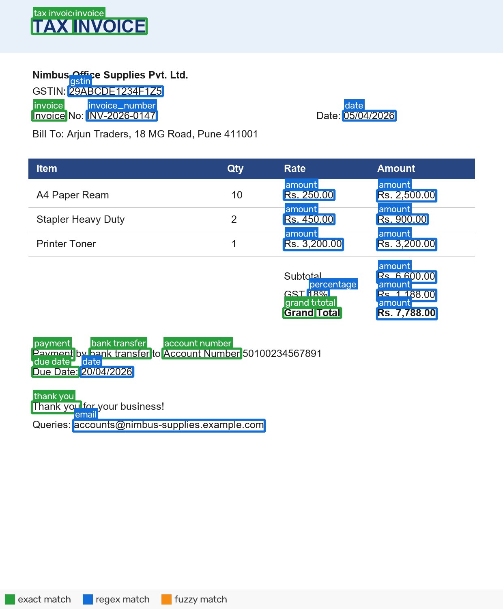

---

## Data structures that flow through the pipeline

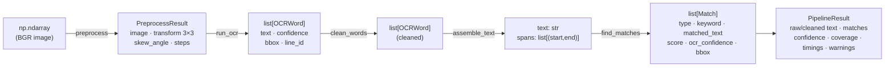

| Class | File | Key fields |
|---|---|---|
| `PreprocessOptions` | preprocessing.py | `resize, scale, grayscale, contrast, denoise, kernel_size, deskew, threshold, block_size, adaptive_c` + presets `disabled()`, `standard()`, `rescue()` |
| `OCRWord` | ocr_engine.py | `text, confidence (0-100), bbox (x,y,w,h), line_id` |
| `Match` | matching.py | `match_type, keyword, matched_text, score, ocr_confidence, bbox, line_boxes, word_indices, start, end` |
| `MatchConfig` | config.py | `keywords, phrases, patterns, fuzzy_threshold, min_fuzzy_length, low_confidence_threshold, min_text_coverage` |
| `PipelineResult` | pipeline.py | `image_name, raw_text, cleaned_text, words, matches, mean_confidence, text_coverage, skew_angle, timings, warnings` (+ images for display) |

---

## The decision point: detecting a bad OCR pass

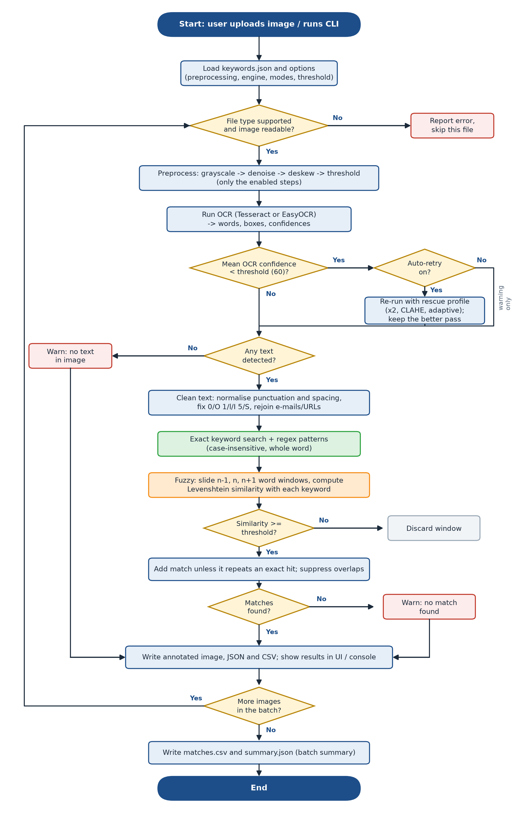

After the first OCR pass the orchestrator asks: **does this result look poor?**

| Signal | Detects | Threshold |
|---|---|---|
| **Mean OCR confidence** | characters that were *misread* | < 60 |
| **Text coverage**, the share of ink pixels (adaptive-threshold mask) that fall inside OCR word boxes | text that was ***missed entirely*** | < 0.50 |

**Why coverage was needed:** words that are never read don't lower the average confidence. On the low-contrast notice, Tesseract returned 11 of 40 words with mean confidence 87.6, so a confidence-only check would call that page a success.

If either signal fires (and auto-retry is on), the image is processed again with the **rescue profile** (×2 upscale, CLAHE, median blur, deskew, adaptive threshold), and the pass with the higher **quality score = coverage × confidence** is kept. All of this is reported in `warnings`.

| Image | Confidence | Coverage | Retried? | Char. accuracy |
|---|:-:|:-:|:-:|:-:|
| 01 printed document | 95.7 | 1.00 | no | 100 % |
| 04 e-mail screenshot | 95.2 | 0.56 | no | 97.5 % |
| **08 low-contrast notice** | 87.6 → 87.0 | **0.44 → 0.92** | **yes** | **31.1 % → 97.2 %** |

Running the retry **only when a check fails** matters: if the heavy profile were applied everywhere, it would *reduce* accuracy on clean images such as the invoice and the poster.

<br clear="right"/>

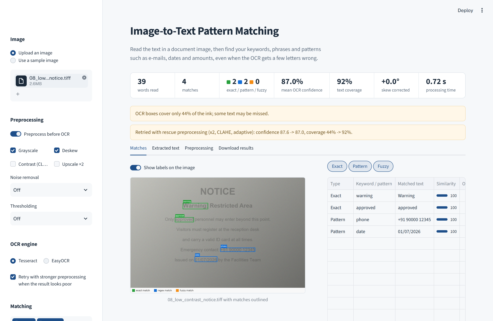

---

## Configuration

Everything the matcher looks for lives in [`config/keywords.json`](config/keywords.json) (YAML also works). **No keyword is hard-coded.**

```json
{
  "keywords": ["invoice", "receipt", "total", "payment", "refund", "confidential", "urgent", "password", "..."],
  "phrases":  ["tax invoice", "grand total", "due date", "account number", "terms and conditions", "..."],
  "patterns": {
    "email":   {"regex": "[A-Za-z0-9._%+-]+@[A-Za-z0-9-]+(?:\\.[A-Za-z0-9-]+)*\\.[A-Za-z]{2,}", "description": "E-mail address"},
    "amount":  {"regex": "(?:Rs\\.?|INR|USD|\\$)\\s?\\d{1,3}(?:,\\d{2,3})*(?:\\.\\d{2})?", "description": "Currency amounts"}
  },
  "settings": {
    "fuzzy_threshold": 90,
    "min_fuzzy_length": 4,
    "min_word_confidence": 0,
    "low_confidence_threshold": 60,
    "min_text_coverage": 0.5
  }
}
```

| Pattern | Matches |
|---|---|
| `email` | `legal@nimbus-supplies.example.com` |
| `url` | `www.megamart.example.in`, `https://…/verify` (never swallows a trailing full stop) |
| `phone` | `+91 98765 43210`, `(0120) 456 7890` |
| `date` | `21/03/2026`, `2026-07-15`, `14 March 2026` |
| `invoice_number` | `INV-2026-0147`, `RCPT-88213`, `BILL-2026-0932` |
| `amount` | `Rs. 7,788.00`, `INR 4,500`, `$49.99` (Indian lakh grouping supported) |
| `gstin` | `29ABCDE1234F1Z5` |
| `percentage` | `18%`, `12.5 %` |

Invalid regexes are rejected at load time with a clear `ConfigError`. In the web UI you can also edit the keyword list live, choose which patterns are active, and upload another config file.

---

## Interfaces

### Command line ([`cli.py`](cli.py))

```bash
python cli.py --input data/samples                          # whole folder
python cli.py --input data/samples/02_invoice.png             # one image
python cli.py --input data/samples --engine easyocr           # second engine (local)
python cli.py --input data/samples --no-preprocess            # compare without preprocessing
python cli.py --input scan.jpg --threshold adaptive --clahe --resize 2
python cli.py --input data/samples --modes exact regex        # disable fuzzy
python cli.py --input data/samples --fuzzy-threshold 85 --keywords "sale,offer"
python cli.py --help
```

| Group | Options |
|---|---|
| Input / output | `-i/--input`, `-c/--config`, `-o/--output`, `-r/--recursive`, `--keywords`, `--no-annotate`, `--quiet` |
| OCR | `--engine {tesseract,easyocr}`, `--lang` (e.g. `eng+hin`), `--psm`, `--no-retry` |
| Preprocessing | `--no-preprocess`, `--no-grayscale`, `--denoise {none,median,gaussian}`, `--kernel`, `--threshold {none,otsu,adaptive}`, `--no-deskew`, `--resize SCALE`, `--clahe` |
| Matching | `--modes exact regex fuzzy`, `--fuzzy-threshold`, `--no-clean` |

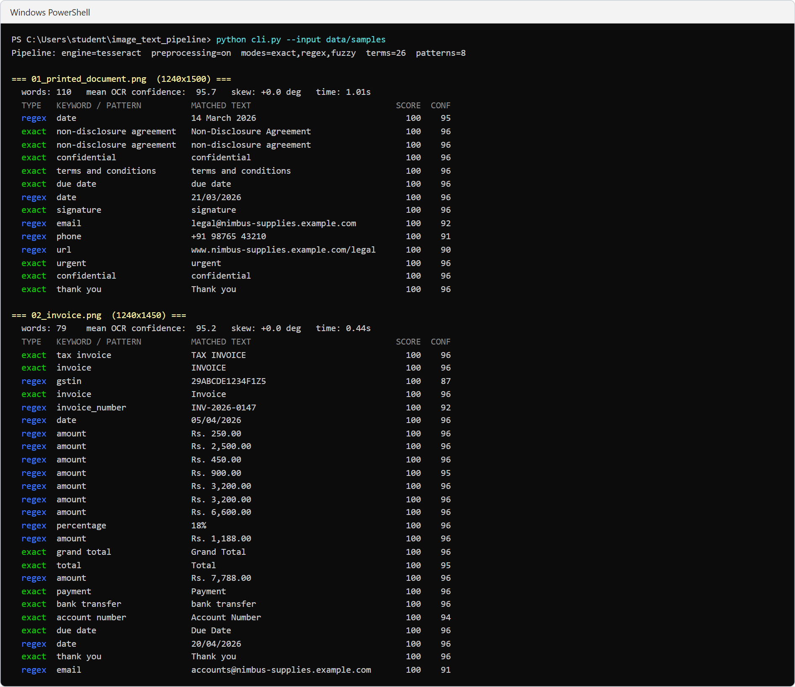

### Web UI ([`app.py`](app.py))

`streamlit run app.py` (or double-click `run_ui.bat` on Windows).

* **Sidebar** (in pipeline order): image source, preprocessing toggles, OCR engine, auto-retry, matching modes, fuzzy threshold slider, keyword editor, pattern selector, config upload.
* **Stats strip:** words read · matches by type · mean confidence · text coverage · skew corrected · processing time.
* **Tabs:** Matches (annotated image + filterable table with similarity bars) · Extracted text (cleaned text with highlighter marks in match colours; raw OCR toggle) · Preprocessing (before/after + every intermediate step) · Download results (JSON, CSV, PNG + JSON preview).
* The pipeline call is wrapped in `st.cache_data`, keyed on the image bytes, options and config, so switching tabs never re-runs OCR.

| Highlighted text | A fuzzy match rescuing an OCR error |
|---|---|
| 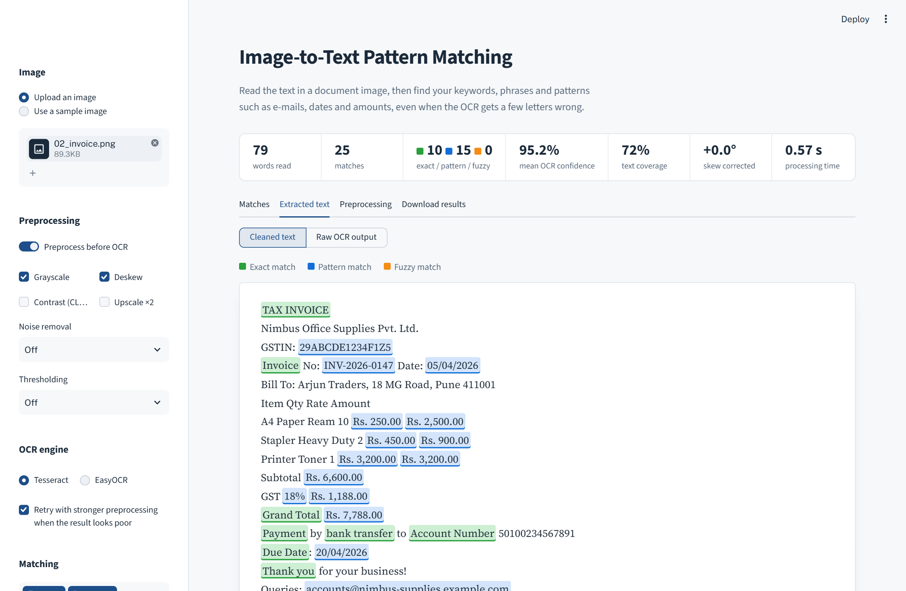 | 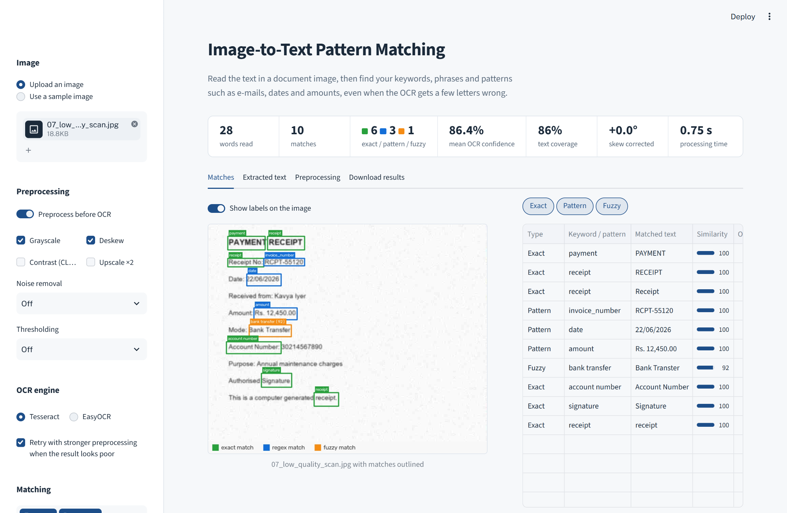 |

<details>
<summary><b>Preprocessing tab</b></summary>

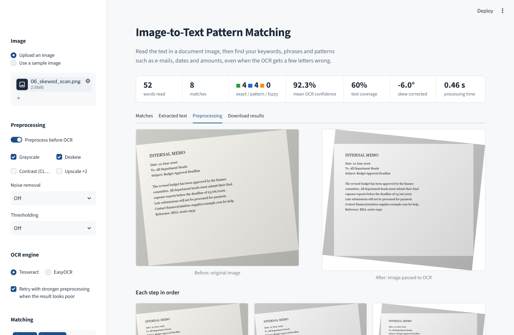
</details>

---

## Outputs

**`outputs/json/<image>.json`** (one per image; excerpt from the real output for `02_invoice.png`):

```json
{
  "image": "02_invoice.png",
  "image_size": {"width": 1240, "height": 1450},
  "ocr_engine": "tesseract",
  "preprocessing": {"grayscale": true, "denoise": "none", "deskew": true, "threshold": "none", "...": "...", "enabled": true},
  "skew_angle_deg": 0.0,
  "mean_ocr_confidence": 95.19,
  "text_coverage": 0.7232,
  "word_count": 79,
  "extracted_text": "TAX INVOICE\nNimbus Office Supplies Pvt. Ltd.\n...",
  "cleaned_text": "TAX INVOICE\nNimbus Office Supplies Pvt. Ltd.\n...",
  "match_count": 25,
  "matches": [
    {"match_type": "regex", "keyword": "invoice_number", "matched_text": "INV-2026-0147",
     "score": 100.0, "ocr_confidence": 92.0, "bbox": [216, 275, 167, 18],
     "word_indices": [11], "start": 80, "end": 93}
  ],
  "processing_time_s": {"preprocessing": 0.0785, "ocr": 0.345, "cleaning": 0.0005, "matching": 0.0038, "total": 0.4384},
  "warnings": [],
  "words": [{"text": "TAX", "confidence": 96.0, "bbox": [81, 48, 87, 32], "line_id": 0}]
}
```

**`outputs/matches.csv`** columns: `image, match_type, keyword, matched_text, score, ocr_confidence, bbox_x, bbox_y, bbox_w, bbox_h, processing_time_s`

**`outputs/summary.json`:** images processed / failed (with reasons), total matches, matches by type and by keyword, images without matches, mean confidence, total and mean time.

**`outputs/annotated/<image>_annotated.png`**: the original image with boxes and a legend.

---

## Evaluation results

### Test set

Accuracy can only be measured when the true text is known exactly, so [`scripts/generate_samples.py`](scripts/generate_samples.py) draws 10 documents with real fonts, records every line as ground truth ([`data/ground_truth.json`](data/ground_truth.json)), and degrades them in a controlled way:

| Image | Type | Difficulty |
|---|---|---|
| 01_printed_document.png | Letter | Clean serif text, e-mail, URL, phone |
| 02_invoice.png | Invoice | Table layout, coloured header, GSTIN, amounts |
| 03_receipt.jpeg | Receipt | Monospace, speckle noise, tinted paper |
| 04_screenshot_email.png | Screenshot | UI chrome, white-on-dark title bar, phishing cues |
| 05_poster_sign.png | Poster | Huge display fonts on a colour gradient |
| 06_skewed_scan.png | Scan | Rotated 6°, uneven light, noise |
| 07_low_quality_scan.jpg | Scan | Small text, blur, noise, JPEG quality 22 |
| 08_low_contrast_notice.tiff | Photo | Grey-on-grey, 45 % lighting gradient |
| 09_id_card.bmp | ID card | Fields, coloured header (clearly marked SPECIMEN) |
| 10_small_font_form.png | Form | 16 px text, two columns, **decoy words** (`invoiced`, `totals`, `Payments`) |

Together: **53 keyword occurrences** and **54 regex values**.

### Metrics

* **Character accuracy** = `1 − Levenshtein(OCR, truth) / len(truth)` (lower-cased, whitespace collapsed). **Word accuracy** = the same on word sequences. Both are order-sensitive.
* **Precision / recall / F1** are counted per **occurrence**. Ground-truth detections = what the exact matcher finds on the *ground-truth text* (i.e. what a perfect OCR would allow).
* **Time** = wall-clock per image for all stages, after a warm-up image.

### OCR accuracy per configuration

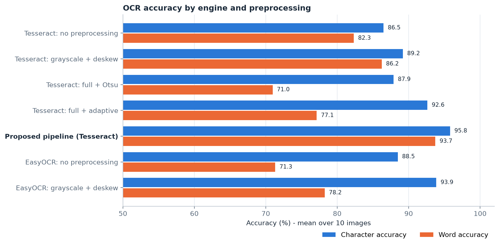

### No single preprocessing setting wins everywhere

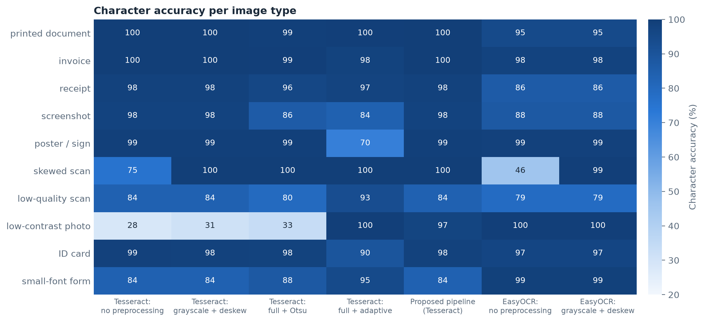

* Deskew alone: skewed scan **75.4 % → 100 %**.
* Adaptive threshold: low-contrast notice **31 % → 99.6 %**, but the poster **99.4 % → 70.3 %** (its 31-px window is smaller than the huge letters, so only outlines survive).
* EasyOCR without deskew collapses on the skewed scan (**45.6 %**).

### Exact vs. fuzzy, and choosing the threshold

| | Exact only | Exact + fuzzy (90) |
|---|:-:|:-:|
| Final pipeline: precision / recall / F1 | 1.000 / 0.981 / 0.991 | **1.000 / 1.000 / 1.000** |
| Noisier OCR (Otsu): F1 | 0.951 | 0.961 |

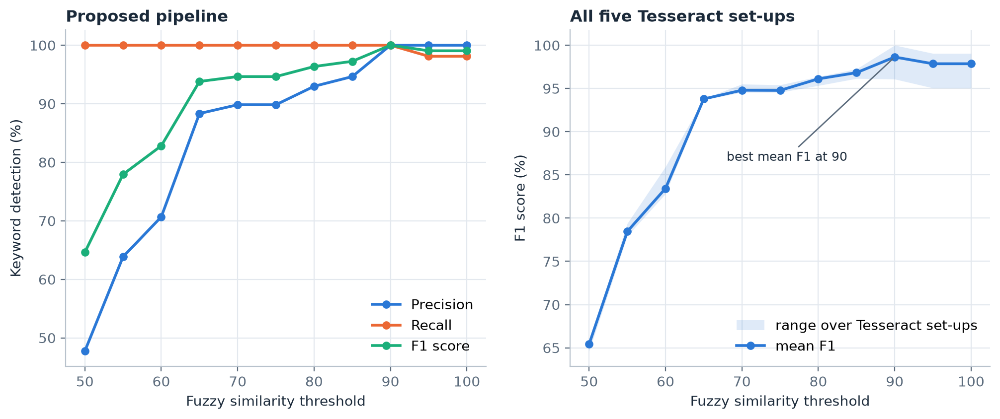

| Threshold | 50 | 60 | 70 | 80 | 85 | **90** | 95 | 100 |
|---|---|---|---|---|---|---|---|---|
| Precision | 0.477 | 0.707 | 0.898 | 0.930 | 0.946 | **1.000** | 1.000 | 1.000 |
| Recall | 1.000 | 1.000 | 1.000 | 1.000 | 1.000 | **1.000** | 0.981 | 0.981 |
| False positives | 58 | 22 | 6 | 4 | 3 | **0** | 0 | 0 |

At 80–85 the decoys still match (`invoice`→`invoiced`, `total`→`totals`, `payment`→`Payments`). **90 gave the best mean F1 over all five Tesseract set-ups (0.986)** and is the default. At 90, a 10-letter word may contain one wrong letter; a 5-letter word may not (one edit → 80).

### Regex extraction per pattern

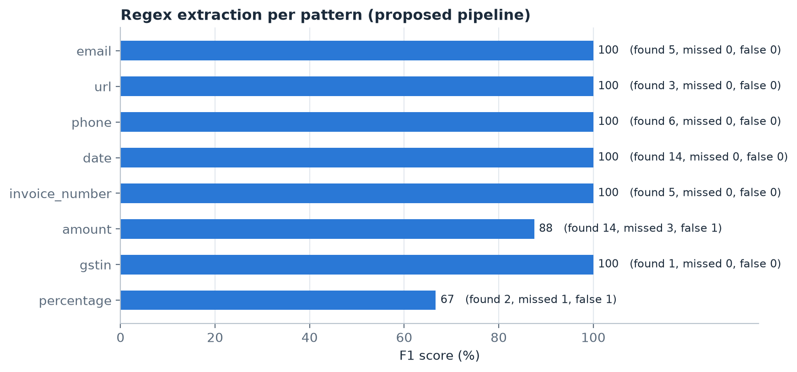

E-mail, URL, phone, date, invoice number and GSTIN: **F1 = 1.000**. Misses come from OCR noise near punctuation (`Rs..12@.00` on the speckled receipt) and a plausible-but-wrong read (`50%` → `90%` in the Impact font).

### Text cleaning (ablation) and speed

| Cleaning | Char. accuracy | Keyword F1 | Regex F1 |
|---|:-:|:-:|:-:|
| off | 95.3 % | 1.000 | 0.933 |
| **on** | **95.8 %** | 1.000 | **0.943** |

The gain comes from removing noise tokens and rejoining `finance @nimbus-supplies.example.com`. Processing time is dominated by OCR (≈ 0.29 s of 0.38 s); cleaning + matching take a few milliseconds thanks to RapidFuzz's C++ core and the length filter. EasyOCR needs ≈ 3.2 s/image on CPU.

> Re-create everything with `python evaluation/evaluate.py && python scripts/make_charts.py`. All tables live in [`evaluation/results/`](evaluation/results).

---

## Design decisions and trade-offs

| Decision | Why | Alternative considered |
|---|---|---|
| **Tesseract as primary engine** | Fast on CPU (0.3 s/image), exact word boxes and confidences, best regex F1 | EasyOCR: higher raw char. accuracy on some images but 8× slower, segment-level boxes, drops punctuation |
| **Light default preprocessing (grayscale + deskew)** | Best word accuracy, keyword F1 and regex F1 in the evaluation | Full chain with Otsu: hurt clean images (word acc. 71 %) |
| **Heavy preprocessing only on demand** | Different images need opposite treatments | Fixed profile, or always running both passes (2× cost) |
| **Coverage × confidence as quality score** | Confidence alone keeps the bad pass on faint pages; coverage alone prefers garbled passes on posters | Confidence only, coverage only |
| **Match on the joined text + span map** | Regexes and phrases work across word and line boundaries and still map to boxes | Matching word by word (can't find `Rs. 1,250.00` or phrases) |
| **Normalised Levenshtein on word windows** | Explainable, aligned to word boxes, catches split/merged words with n±1 windows | Substring fuzzy search (no clean boxes), phonetic matching (wrong error model for OCR) |
| **Exact hits suppress overlapping fuzzy hits** | No duplicate reports | Report both |
| **Keywords in JSON/YAML** | Non-programmers can change what is searched; validated at load | Hard-coded lists |
| **Synthetic test set** | Exact ground truth and controlled difficulty | Real photos (no exact truth without manual transcription) |

---

## Limitations and future work

**Limitations (stated honestly):**

* Evaluated on **10 synthetic images**. Real photos (perspective, glare, folds) are harder.
* The fuzzy threshold (90), the coverage limit (0.5) and the defaults were **tuned on the same 10 images** they were evaluated on. The coverage margin is small (failing image 0.44; next lowest 0.56).
* The retry did **not** fire on the blurred, low-quality scan (coverage 0.86, confidence 86.4), although adaptive thresholding would have raised it from 83.7 % to 93.1 %.
* Multi-column layouts are read column by column, which lowers the order-sensitive accuracy metric even when every word is right.
* English, single-page raster images, printed text only. Keywords shorter than 4 characters are not fuzzy-matched.

**Future work:** TrOCR for handwriting · multilingual packs (`--lang eng+hin`) · PDF input (render pages or use the text layer) · layout-aware NER (LayoutLM) for "invoice total"-style fields · blur/contrast measures in the retry rule · Docker image + REST API + job queue for large batches.

---

## Project structure

```
image-to-text-pattern-matching/
├── app.py                     Streamlit web UI (local)
├── app_gradio.py              Gradio web UI (hosted on Hugging Face Spaces)
├── Dockerfile                 container image with Tesseract + EasyOCR
├── cli.py                     command-line interface
├── run_ui.bat                 starts the web UI on Windows
├── requirements.txt           core dependencies (used by the cloud deployment)
├── requirements-easyocr.txt   + optional EasyOCR engine
├── packages.txt               system packages for Streamlit Cloud (tesseract-ocr)
├── .streamlit/config.toml     light theme, upload limit
├── config/keywords.json       keywords, phrases, regex patterns, thresholds
├── ocrmatch/                  the pipeline package (one module per stage)
│   ├── io_utils.py            stage 1: input validation and decoding
│   ├── preprocessing.py       stage 2: OpenCV steps, deskew, text coverage
│   ├── ocr_engine.py          stage 3: Tesseract / EasyOCR, text + span map
│   ├── cleaning.py            stage 4: normalisation and OCR repairs
│   ├── matching.py            stage 5: exact, regex, fuzzy
│   ├── output.py              stage 6: annotation, JSON / CSV, summary
│   ├── pipeline.py            orchestrator + decision point
│   └── config.py              JSON / YAML config loader and validation
├── data/
│   ├── samples/               10 test images (PNG, JPEG, JPG, BMP, TIFF)
│   ├── ground_truth.json      exact text of every sample
│   └── edge_cases/            a corrupt image and a non-image file
├── evaluation/
│   ├── evaluate.py            accuracy, P/R/F1, threshold sweep, timing
│   └── results/               CSV tables, results.json, charts/
├── scripts/                   sample generator, diagrams, charts, screenshots
├── tests/                     53 pytest unit tests
├── docs/images/               diagrams and screenshots used in this README
└── .github/workflows/         CI: tests + CLI smoke run on every push
```

---

## Run it locally

**1. Install the Tesseract binary** (`pytesseract` is only a wrapper):

| OS | Command |
|---|---|
| Windows | `winget install --id UB-Mannheim.TesseractOCR -e` (or the installer from [UB-Mannheim](https://github.com/UB-Mannheim/tesseract/wiki)) |
| Ubuntu / Debian | `sudo apt install -y tesseract-ocr` |
| macOS | `brew install tesseract` |

Check with `tesseract --version` (4.0+ required; developed with 5.4). A non-standard install location can be given with the `TESSERACT_CMD` environment variable.

**2. Install the Python packages (Python 3.10+):**

```bash
git clone https://github.com/amartya1056/image-to-text-pattern-matching.git
cd image-to-text-pattern-matching
python -m venv .venv
.venv\Scripts\activate            # Windows
source .venv/bin/activate         # Linux / macOS
pip install -r requirements.txt   # or requirements-easyocr.txt to add EasyOCR (~1 GB)
```

**3. Run:**

```bash
streamlit run app.py                     # web UI on http://localhost:8501
python cli.py --input data/samples       # batch run -> outputs/
```

---

## Testing

```bash
python -m pytest -v
```

53 tests cover:

* **cleaning:** look-alike repairs (`2O24`, `Tota1`, `5OO`), protected tokens (`COVID19`, `user123`, `5kg`, GSTIN), noise removal, e-mail/URL rejoining across words but not across lines.
* **matching:** case-insensitive whole-word search, phrases across lines, regex extraction and box mapping, similarity maths, threshold behaviour, split/merged words, short-keyword guard, exact/fuzzy de-duplication, URL full-stop handling.
* **preprocessing / input:** deskew recovers ±3–8° rotations within 0.5°, thresholds produce binary images, the coordinate transform maps points correctly, text coverage detects missed lines, corrupt/unsupported/missing files raise clear errors.

GitHub Actions runs the tests and a CLI smoke test on every push.

---

## Deployment

**Hugging Face Spaces (live demo).** The [Space](https://huggingface.co/spaces/amartya1056/MPPM) runs [`app_gradio.py`](app_gradio.py) on the free Gradio SDK:

* `packages.txt` makes the Space `apt install` **tesseract-ocr**; the Space's `requirements.txt` adds `easyocr`.
* On ZeroGPU hardware, EasyOCR borrows a GPU only while it runs (`@spaces.GPU`); Tesseract runs on the CPU.
* The Space's README starts with a YAML header (`sdk: gradio`, `app_file: app_gradio.py`) and images are stored with Git LFS.

**Docker (any server).**

```bash
docker build -t ocrmatch .
docker run -p 7860:7860 ocrmatch      # Streamlit UI on http://localhost:7860
```

The image installs Tesseract, CPU-only PyTorch and EasyOCR, and pre-downloads the EasyOCR models.

**Streamlit Community Cloud.** `requirements.txt` + `packages.txt` are also ready for [share.streamlit.io](https://share.streamlit.io) (main file `app.py`).

---

## Troubleshooting

| Symptom | Fix |
|---|---|
| `Tesseract binary not found` | Install Tesseract (see above) or set `TESSERACT_CMD` to the full path of `tesseract(.exe)` |
| EasyOCR not offered in the UI | `pip install -r requirements-easyocr.txt` (local only) |
| First run is slow | Tesseract / EasyOCR warm-up; later runs are cached |
| Few words read on a faint photo | Leave auto-retry on, or enable *Adaptive* thresholding + *Upscale ×2* + *Contrast* |
| Big letters come out as outlines | Turn thresholding **off** for posters and signs (adaptive window is smaller than the letters) |
| Too many fuzzy matches | Raise the fuzzy threshold (90+) or disable fuzzy mode |
| A value isn't extracted | Check the OCR text in the *Extracted text* tab; adjust the regex in `keywords.json` |

---

## FAQ: questions you may be asked

<details>
<summary><b>What is OCR, and how does Tesseract work?</b></summary>

OCR converts an image of text into machine-readable characters. Tesseract (v4+) first analyses the page layout: it finds connected components, groups them into text lines and blocks, and orders them. Each **text line** is then fed to an **LSTM** neural network that predicts the character sequence, so it reads whole lines with context rather than isolated letters. It reports a box and a confidence for every word, which this project uses for highlighting and quality checks.
</details>

<details>
<summary><b>Why preprocess at all if Tesseract already binarises internally?</b></summary>

Some degradations are not fixed by binarisation: **rotation** (deskew fixed the skewed scan from 75 % to 100 %), **uneven lighting** (adaptive thresholding fixed the low-contrast notice from 31 % to 99.6 %), and tiny text (upscaling). But adding *another* global threshold to clean images hurt (word accuracy fell to 71 %). That is why the default is light and the heavy profile is applied only when the quality check fails.
</details>

<details>
<summary><b>Explain Otsu's method in one minute.</b></summary>

Treat thresholding as splitting the gray-level histogram into two classes (ink and paper). For every threshold `t`, compute the class weights `ω₀, ω₁` and means `μ₀, μ₁`; the between-class variance is `ω₀ω₁(μ₀−μ₁)²`. The `t` that maximises it best separates the two peaks. It needs no parameters, but it assumes a bimodal histogram, which breaks under a lighting gradient. That's when adaptive thresholding is used.
</details>

<details>
<summary><b>How does deskew find the angle?</b></summary>

Projection profile: rotate the ink mask through candidate angles (−15°…+15°, then refine by 0.1°), count ink pixels per row, and score `Σ(row[i+1]−row[i])²`. Horizontal lines give sharp alternations between text rows and gaps, so the score peaks at the correct angle. Unit tests confirm it recovers ±3–8° within 0.5°.
</details>

<details>
<summary><b>How do you draw boxes on the original image after rotating and resizing?</b></summary>

Every geometric step multiplies a 3×3 transform matrix (original → processed). OCR boxes are in processed coordinates, so the output stage multiplies each box's four corners by the **inverse** matrix and draws a polygon on the original image.
</details>

<details>
<summary><b>How is a regex match connected to a bounding box?</b></summary>

When OCR words are joined into a string, the start/end character position of each word is recorded (the *span map*). A regex returns character positions; every word whose span overlaps them belongs to the match, and their boxes (united per line) are the match's boxes. The match's OCR confidence is the mean of those words.
</details>

<details>
<summary><b>What is Levenshtein distance and why use it?</b></summary>

The minimum number of single-character insertions, deletions and substitutions to turn one string into another, computed with dynamic programming in O(m·n). OCR errors are exactly such edits (`l`↔`i`, a dropped letter), so it is the natural error model. It is normalised to a 0–100 similarity: `100·(1 − d / max(len))`.
</details>

<details>
<summary><b>Why compare against word windows of size n−1, n, n+1?</b></summary>

`n` handles normal cases; `n+1` catches a word split by OCR (`in voice`); `n−1` catches words merged by OCR (`accountnumber` vs `account number`). Windows keep matches aligned to word boundaries, and therefore to boxes.
</details>

<details>
<summary><b>How did you choose the fuzzy threshold of 90?</b></summary>

By a sweep from 50 to 100 on all five Tesseract configurations. Low thresholds match decoys (`invoiced`, `totals`) and unrelated words; high thresholds become exact matching. 90 had the best mean F1 (0.986) and gave P = R = 1.0 on the final pipeline. Caveat: it was tuned on the evaluation set itself.
</details>

<details>
<summary><b>Why not just use EasyOCR, which had higher character accuracy?</b></summary>

EasyOCR is ~8× slower on CPU (3.2 s vs 0.38 s), returns segment-level boxes (word boxes must be approximated), and often drops or alters punctuation (`Rs 2,500.00`, `example com`, `1Z5`→`IZS`), so its regex F1 was only 0.714 vs 0.943. For finding structured values, Tesseract plus this pipeline was better. EasyOCR stays available for comparison.
</details>

<details>
<summary><b>What is "text coverage" and why is it needed?</b></summary>

The fraction of ink pixels (found with an adaptive threshold that also sees faint text) that lie inside OCR word boxes. If OCR skips whole lines, coverage drops even though the confidence of the words it *did* read stays high. It turned a silent failure (11 of 40 words read, confidence 87.6) into a detected and repaired one.
</details>

<details>
<summary><b>How do you avoid corrupting valid text when fixing 0/O, 1/l, 5/S?</b></summary>

Context: each alphanumeric run is classified as numeric or alphabetic, and only *isolated* look-alikes are converted. A digit touching another digit (`COVID19`), or a leading quantity (`5kg`), is never changed. Unit tests pin this behaviour.
</details>

<details>
<summary><b>How are precision and recall computed?</b></summary>

Per occurrence. The ground-truth set is what exact matching finds on the clean ground-truth text. TP = occurrences found in both; FP = found only in the prediction; FN = only in the ground truth. P = TP/(TP+FP), R = TP/(TP+FN), F1 = 2PR/(P+R). Regex values are compared after lower-casing and removing spaces.
</details>

<details>
<summary><b>Why is the test data synthetic?</b></summary>

Character accuracy needs the exact true text. Synthetic images give perfect ground truth and controlled, repeatable degradations (skew, blur, JPEG, low contrast, small fonts). The limitation is that real photos are more varied; real images can be added to `data/samples/` and scored by adding their text to `ground_truth.json`.
</details>

<details>
<summary><b>What happens with a corrupt file or an image with no text?</b></summary>

Corrupt or unsupported files raise `ImageLoadError`, are listed under failures in `summary.json`, and the batch continues. An image with no text produces a result with a "No text was detected" warning; no matches gives "No keyword or pattern matches were found".
</details>

<details>
<summary><b>What is the time complexity of matching?</b></summary>

Exact and regex matching are linear in the text length per pattern. Fuzzy matching is O(K · W · 3 · L²) for K keywords, W words and string length L, but the length filter skips most windows before the DP runs, and RapidFuzz runs in C++. In practice cleaning + matching take a few milliseconds per image; OCR dominates.
</details>

<details>
<summary><b>How would you scale this to thousands of documents?</b></summary>

The stages are stateless, so images can be processed in parallel (process pool or a job queue such as Celery/RQ), Tesseract can run in several worker containers, results can go to a database instead of files, and the Streamlit UI can be replaced by a REST API (FastAPI) for system integration.
</details>

---

## References

1. R. Smith, "An overview of the Tesseract OCR engine," *ICDAR*, 2007, pp. 629–633.
2. B. Shi, X. Bai, C. Yao, "An end-to-end trainable neural network for image-based sequence recognition and its application to scene text recognition," *IEEE TPAMI*, 39(11), 2017.
3. Y. Baek et al., "Character region awareness for text detection," *CVPR*, 2019.
4. N. Otsu, "A threshold selection method from gray-level histograms," *IEEE Trans. SMC*, 9(1), 1979.
5. J. Sauvola, M. Pietikäinen, "Adaptive document image binarization," *Pattern Recognition*, 33(2), 2000.
6. V. I. Levenshtein, "Binary codes capable of correcting deletions, insertions, and reversals," *Soviet Physics Doklady*, 10(8), 1966.
7. R. A. Wagner, M. J. Fischer, "The string-to-string correction problem," *J. ACM*, 21(1), 1974.
8. G. Navarro, "A guided tour to approximate string matching," *ACM Computing Surveys*, 33(1), 2001.
9. K. Thompson, "Regular expression search algorithm," *Commun. ACM*, 11(6), 1968.
10. [Tesseract documentation: Improving the quality of the output](https://tesseract-ocr.github.io/tessdoc/ImproveQuality.html) · [EasyOCR](https://github.com/JaidedAI/EasyOCR) · [RapidFuzz](https://github.com/rapidfuzz/RapidFuzz) · [OpenCV thresholding](https://docs.opencv.org/4.x/d7/d4d/tutorial_py_thresholding.html) · [Streamlit](https://docs.streamlit.io)

---

<div align="center">

Built as an academic mini project · Python · OpenCV · Tesseract · RapidFuzz · Streamlit

</div>
